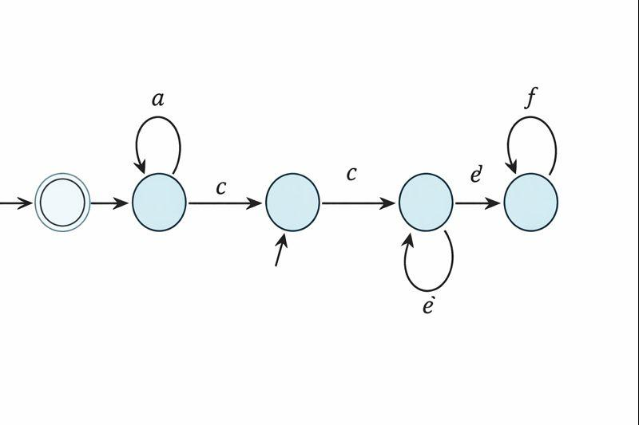
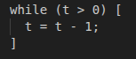
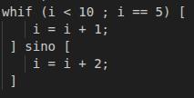
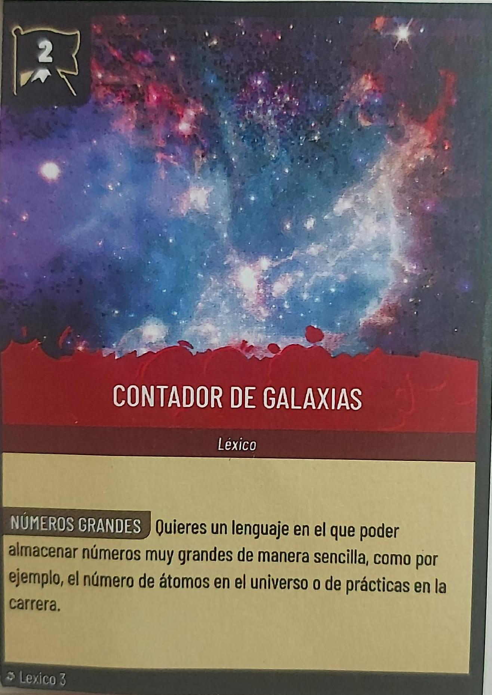
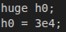

# Fichero especificación del léxico y la sintaxis de nuestro proyecto.

Integrantes del grupo: Bruno Lozano Clemente, Álvaro Cepeda Ramos y Bruno Fernández Mínguez.

## Introducción:

El objetivo de este proyecto es desarrollar nuestro propio compilador a partir de una base proporcionada, ampliando progresivamente sus capacidades. En este fichero se documenta la especificación léxica, sintáctica y parte del análisis semántico del lenguaje resultante, describiendo tanto las implementaciones mínimas como las distintas cartas de ampliación. Además, se incluyen una serie de códigos de ejemplo que permiten probar las funcionalidades implementadas y verificar el correcto funcionamiento del compilador.

## Implementaciones mínimas:

En esta parte del proyecto se describen las implementaciones mínimas del lenguaje, incluyendo estructuras de control, tipos básicos y operadores infijos. Estas construcciones permiten definir el comportamiento esencial del lenguaje y sirven como base para el análisis léxico y semántico, así como para la ejecución correcta de los programas.

Cada elemento se define indicando cómo se reconoce a nivel léxico, restricciones a nivel semántico y los errores a los que puede dar lugar.

### Conjunto de instrucciones del lenguaje:

#### While

La clase While implementa un bucle simple con una condición booleana (**cond**) y un cuerpo (**body**). Semánticamente, la condición debe ser de tipo **BOOL** (error **TYPECOND** si no); el bucle se ejecuta mientras la condición sea **true**, y el cuerpo se evalúa en cada iteración.

Léxicamente, se identifica con el token while seguido de paréntesis con la expresión condicional y el bloque entre corchetes.

<em>donde t &gt; 0 es cond y t = t -1 es el body</em>

### Identificadores y ámbitos de definición:

#### Real

La clase Real maneja literales de números reales (flotantes). Semánticamente, su tipo es **REAL**, y se ejecuta convirtiendo el lexema a Double; no genera errores específicos en análisis semántico. Léxicamente, se reconoce como un número entero seguido de punto y dígitos opcionales (digito+{.}digito+) produciendo el token **REAL**.

### Operadores Infijos:

#### Mayor o igual (>=)

El operador **MAYOR_IGUAL** en EBin compara dos operandos numéricos (ent, real o huge) y devuelve un booleano. Semánticamente, genera error **TYPEOP** si los operandos no son numéricos; el resultado es BOOL. Léxicamente, se reconoce con el token **operadorMayorIgual** (`>\=`), y se asocia a la operación binaria en expresiones.

#### Menor o igual (<=)

El operador **MENOR_IGUAL** en EBin compara dos **operandos** numéricos y produce un booleano. Semánticamente, requiere tipos numéricos (**TYPEOP** si no); evalúa si el izquierdo es menor o igual al derecho. Léxicamente, se identifica con **operadorMenorIgual** (`<\=`), usado en expresiones binarias.

#### Menor (<)

El operador **MENOR** en **EBin** compara dos valores numéricos y retorna booleano. Semánticamente, exige operandos numéricos (**TYPEOP** si no); verifica si el izquierdo es menor que el derecho. Léxicamente, se reconoce con **operadorMenor** (`\<`), integrado en operaciones binarias.

#### Divide (/)

El operador **DIVIDE** en **EBin** divide dos operandos numéricos y devuelve un número (ent o real). Semánticamente, requiere tipos numéricos (**TYPEOP** si no); el resultado es NUM o REAL según operandos. Léxicamente, se identifica con **operadorDivide** (`\/`), usado en expresiones aritméticas.

#### Distinto (!=)

El operador **DISTINTO** en **EBin** compara dos operandos del mismo tipo y produce booleano. Semánticamente, genera **TYPEOP** si los tipos difieren; evalúa desigualdad. Léxicamente, se reconoce con **operadorDistinto** (`\!\=`), en comparaciones binarias.

### Tipos de Errores en el Proyecto:

A continuación se describen los distintos tipos de errores que pueden comunicarse al usuario:

1. **DUPIDEN:** Definición duplicada de un identificador en el mismo scope.

2. **NOIDEN:** Uso de un identificador no definido.

3. **TYPEOP:** Tipos incompatibles en un operador (ej. sumar bool y ent).

4. **TYPECOND:** Condición no booleana en si, while o whif.

5. **TYPEASIG:** Tipo de la expresión asignada no coincide con la variable.

6. **NOVALUE:** Lectura de variable sin valor asignado (runtime).

7. **TOOBIG:** Número demasiado grande (ej. base/exponente >10 dígitos en huge).

8. **OUTOFBOUNDS:** Índice fuera de los límites del array (runtime).

9. **NOTARRAY:** Uso de sintaxis de array en variable no array.

## Cartas de ampliación del lenguaje:

En esta sección se describen distintas cartas del lenguaje desarrolladas en el proyecto, cada una enfocada en una fase diferente del procesamiento: sintaxis, análisis y léxico. Estas cartas amplían las funcionalidades básicas del lenguaje y permiten introducir nuevos comportamientos, tanto a nivel estructural como en la detección de errores y en el reconocimiento de nuevos literales.

### Carta de análisis: capa de invisibilidad.

La capa de invisibilidad del se implementa mediante una pila de tablas de símbolos (TableStack). La detección de variables no leídas se basa en marcar como “leídas” únicamente aquellas variables que aparecen en expresiones (lado derecho de las asignaciones).

Las variables asignadas pero nunca usadas no se consideran leídas. Al finalizar el análisis, se recorren todas las tablas para identificar y avisar sobre aquellas variables que no han sido utilizadas en ninguna expresión.

### Carta de sintaxis: Repite con cuidado.

Para la implementación de esta carta de tipo sintáctica, hicimos uso de **WhileIf**.

WhileIf representa un bucle condicional con dos condiciones: una para el bucle (**condBucle**) y otra para elegir rama (**condIf**).

Semánticamente, ambas condiciones deben ser booleanas (error de tipo **TYPECOND** si no lo son); se ejecuta el bucle mientras condBucle sea true, y en cada iteración evalúa **condIf** para decidir entre el bloque body o bodyElse. Léxicamente, se reconoce con el token **whileif** seguido de paréntesis con las dos expresiones separadas por punto y coma, y bloques entre corchetes.

Su uso es, por tanto, de la siguiente forma:

<em>donde “i &lt; 10” es la condBucle y “i == 5” la condIf.</em>

### Carta de léxico: capa de invisibilidad.

La implementación de esta carta la hicimos mediante la clase **Huge** representa números enormes (exponenciales). Semánticamente, su tipo es **HUGE**; en ejecución, calcula **baseeexponente** como **Long**, pero lanza **TOOBIG** si base o exponente tienen más de 10 dígitos. Léxicamente, se reconoce como número con exponente: {digito}+{e}{exponente}+ (con máximo de 10 en cada caso), produciendo token **HUGE**.

<em>donde “3” es la base y “4” el exponente.</em>

